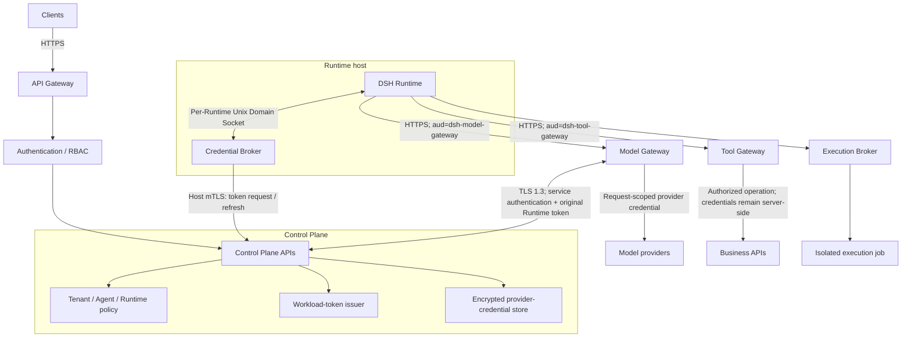

# Security Architecture

English | [中文](architecture.zh.md)

**Status:** Working baseline  
**Scope:** Linux-hosted, provider-independent SaaS platform built around DeepSeek Harness (DSH).

## 1. Product and deployment constraints

- Linux is the only supported host operating system.
- The platform must not depend on a cloud provider's proprietary APIs or products.
- A deployment may run on an ordinary VPS. Hardware virtualization and access to `/dev/kvm` are not assumed.
- The platform has two agent classes: Restricted and Advanced.
- DSH is an agent runtime, not the platform Control Plane and not a security boundary by itself.
- Security controls must be enforced outside the model and outside prompt instructions.

## 2. High-level architecture

The Control Plane owns tenant identity, authentication, lifecycle management, Runtime policy, workload-token signing, encrypted provider-credential persistence, and audit metadata. It is the only service that connects directly to PostgreSQL. DSH runs the agent loop and coordinates model/tool interactions. Production model traffic goes through the provider-independent Model Gateway; business integrations go through the Tool Gateway. Credential Broker only obtains and relays short-lived workload tokens. The Execution Plane runs untrusted code outside the DSH process.

Workload-token issuance and verification are implemented by [dsh-workload-identity](../../packages/identity/workload-identity/README.md). Only the Control Plane holds the Ed25519 private signing key. Model Gateway and Tool Gateway receive public verification keys and independently verify tokens for their exact audiences. DSH Runtime receives short-lived bearer tokens through Credential Broker; it never receives provider or integration credentials.

## 3. Trust boundaries

### 3.1 Control Plane

Responsibilities:
- authenticate users and services;
- create and manage tenants and agents;
- issue short-lived, narrowly scoped workload identities;
- evaluate Runtime policy and derive the capabilities granted to each Runtime and service audience;
- issue short-lived audience-scoped workload tokens after validating the Host/Runtime binding;
- keep the workload-token signing private key and encrypted provider-credential store;
- expose provider-credential resolution only to authenticated Model Gateway instances;
- schedule DSH runtimes and execution jobs;
- record security-relevant audit events.

The Control Plane must not execute model-generated code.

### 3.2 DSH Agent Runtime

Minimum isolation unit: one runtime process/container per tenant. Agents with materially different data scopes or privilege profiles must use separate runtimes.

The DSH runtime:
- receives only the tenant and agent identity required for its work;
- has no host filesystem mounts other than explicitly provisioned tenant-scoped data;
- has no access to Docker/containerd sockets, host credentials, SSH keys, cloud metadata, or Control Plane databases;
- does not store provider API keys or other long-lived integration secrets;
- cannot create containers or sandboxes directly;
- cannot load arbitrary third-party plugins or arbitrary MCP servers in production.

DSH's built-in filesystem and shell sandboxing must not be treated as the tenant isolation boundary.

### 3.3 Tool Gateway

All business integrations go through the Tool Gateway.

The Tool Gateway:
- authenticates DSH Runtime using a short-lived workload token with exact audience `dsh-tool-gateway`;
- verifies the token signature, issuer, audience, expiration, and required capabilities;
- derives tenant, agent, and Runtime identity only from verified claims, never from model-supplied arguments;
- checks capability and object-level permissions on every operation;
- applies tenant scoping to every data access;
- resolves integration credentials through a server-side integration-credential service and uses them only for the specific authorized operation;
- never returns raw integration credentials to DSH Runtime, the Agent Loop, or the model;
- validates inputs and outputs and records security-relevant actions.

### 3.4 Credential Broker

Credential Broker is a separate, unprivileged service whose only responsibility is obtaining and relaying short-lived Workload Identity Tokens.

The Credential Broker:
- exposes a separate Unix Domain Socket for each Runtime;
- authenticates the connecting Runtime using OS peer credentials and maps the socket to a registered Runtime identity;
- accepts only the fixed service audiences `dsh-model-gateway` and `dsh-tool-gateway`;
- authenticates to Control Plane over host-authenticated mTLS;
- obtains tokens only after Control Plane validates the active Host/Runtime binding and derives tenant, agent, Runtime identity, and permitted capabilities from server-side policy;
- relays Control-Plane-signed tokens unchanged and cannot sign, re-sign, broaden, or otherwise modify their claims;
- never holds the Ed25519 private signing key;
- never stores, retrieves, or serves provider credentials, integration credentials, OAuth refresh tokens, or other business secrets.

DSH Runtime keeps active audience-specific tokens in memory only. Execution sandboxes must not receive the Broker socket or workload tokens. Unix socket access alone does not replace downstream token verification and authorization.

### 3.5 Model Gateway

The Model Gateway is the only production SaaS egress path from DSH Runtime to model providers. It is provider-independent and is not limited to DeepSeek.

Responsibilities:
- authenticate DSH Runtime using a short-lived workload token with exact audience `dsh-model-gateway` and required capability `model:invoke`;
- verify the token signature, issuer, audience, expiration, and required capabilities, and derive tenant/agent/Runtime identity only from verified claims;
- enforce tenant-scoped provider/model allowlists, quotas, rate limits, and usage accounting;
- resolve provider credentials through authenticated, versioned Control Plane APIs; Control Plane stores provider credentials encrypted at rest;
- authenticate to Control Plane using its dedicated Model Gateway service-authentication token and forward the original Runtime workload token for independent Control Plane verification and active-binding checks;
- use decrypted provider credentials in request scope only; never persist them in Gateway state or expose them to Runtime;
- translate a stable provider-neutral request/response/streaming contract to provider-specific protocols;
- route to approved hosted or self-hosted model endpoints;
- normalize provider errors and metadata without exposing credentials or internal secrets;
- audit model access and usage with privacy-safe defaults.

The adapter boundary must support multiple vendors and compatible endpoints without requiring provider-specific credentials or routing logic in DSH Runtime. Initial provider scope includes DeepSeek, OpenAI, Anthropic, Google Gemini, Qwen, Mistral, and self-hosted or third-party OpenAI-compatible / Anthropic-compatible endpoints. The list is extensible.

Security requirements:
- DSH Runtime receives no long-lived provider API key or provider OAuth refresh token.
- Model Gateway accepts only authenticated Runtime requests and never trusts tenant, Runtime, or agent identifiers supplied as ordinary model/request fields.
- Provider credentials never appear in Runtime-visible responses, model output, tool calls, errors, logs, traces, or artifacts.
- Model Gateway does not execute business tools; Tool Gateway remains the business-operation boundary.
- Direct provider access from production Runtime is denied by network policy. No fallback to direct provider API calls is permitted.
- Local/self-hosted endpoints are reachable only from Model Gateway under explicit egress policy.

Standalone development/SDK profiles may use direct provider adapters, but they are not the production SaaS security boundary.

### 3.6 Execution Plane

Advanced agents may request code execution through a narrow `run_code` capability.

The Execution Broker:
- authenticates the DSH workload;
- verifies tenant, agent, policy, and resource limits;
- accepts a constrained job specification, not an arbitrary container runtime specification;
- starts a fresh isolated job environment;
- provides only explicitly supplied input files;
- collects bounded output and declared artifacts;
- destroys the job environment after completion or timeout.

The DSH runtime must not have access to the container runtime socket or host-level execution controls.

## 4. Agent classes

### Restricted Agent

Allowed:
- explicitly registered business tools exposed through the Tool Gateway;
- tenant-scoped document and data operations exposed through authorized services.

Not allowed:
- shell access;
- arbitrary Python, JavaScript, or other code execution;
- arbitrary local filesystem access;
- arbitrary network access;
- arbitrary plugin or MCP server installation.

### Advanced Agent

Has the Restricted Agent capabilities plus the `run_code` tool.

Code executes only in the Execution Plane. It does not execute in the DSH process, Control Plane, Tool Gateway, or host.

The execution environment receives no integration credentials, Control Plane credentials, host secrets, or ambient cloud identity.

## 5. Execution isolation strategy

### 5.1 Provider-independent contract

Define a provider interface for execution environments. The initial contract should support:
- capability detection;
- create job;
- submit bounded inputs;
- wait for completion;
- collect bounded outputs/artifacts;
- terminate job;
- destroy job;
- report execution and isolation status.

The agent-facing API must not expose implementation-specific runtime options.

### 5.2 Initial Linux backend

The initial candidate backend is OCI execution through gVisor `runsc`, using the Systrap platform where supported.

Host capability checks happen during deployment and are repeated by the sandbox service before accepting jobs. The implementation must verify the actual runtime selected for each job; it must not assume that configuring an OCI runtime automatically means that runtime is in use.

If the required isolation backend is unavailable, misconfigured, or fails its health checks, Advanced execution is disabled. There is no automatic fallback to an ordinary `runc` container.

KVM and Firecracker are not baseline requirements. A future backend may use microVMs where the host supports them, without changing the agent-facing execution contract.

### 5.3 Job defaults

Unless a reviewed policy explicitly grants otherwise:
- one fresh environment per job;
- non-root user inside the job;
- read-only base image;
- ephemeral writable job directory;
- no host filesystem mounts;
- no host or container-runtime sockets;
- no credentials or ambient service identity;
- no inbound connections;
- outbound network denied by default;
- CPU, memory, process-count, disk, output-size, and wall-clock limits;
- bounded logs and artifacts;
- forced termination on timeout;
- destruction after result collection.

Network access, if later required, must go through a controlled egress component with destination and protocol policy. A general-purpose unrestricted network is not an acceptable default.

## 6. Data and tenant isolation

- Tenant identity is established by authenticated platform context, never trusted from model output.
- Every database query and object-storage operation is tenant-scoped and authorization-checked.
- Tenant data must not be shared through writable host paths.
- Runtime state, workspaces, credentials, and audit records are separated by tenant.
- Cross-tenant access tests are release blockers.
- Tenant-specific encryption and retention policies are enforced by platform services.

## 7. DSH production profile

The first Restricted Agent composition is implemented as the standalone `sdk-minimal` bundle plus the reviewed overlay in [`restricted-profile.md`](restricted-profile.md). It deliberately avoids `dsh-base`, whose shared tool roster is broader than this first SaaS runtime needs.

Production DSH bundles must be deliberately assembled from an allowlist of required capabilities.

The initial Restricted profile must not expose:
- local shell execution;
- arbitrary code/PTC execution in the DSH process;
- unrestricted local filesystem tools;
- unrestricted web fetch;
- arbitrary plugin installation;
- arbitrary MCP server execution;
- local credential stores containing integration secrets.

Advanced execution is exposed only through the broker-backed `run_code` tool.

The exact Cordis bundle and capability IDs must be verified against the pinned DSH commit before implementation. Do not assume a capability is disabled merely because its UI is hidden.

## 8. Security invariants

1. Model output cannot grant itself permissions.
2. Tenant and agent identity come from authenticated server-side context.
3. DSH cannot read long-lived integration credentials or model-provider credentials; Credential Broker handles only short-lived workload-token relay, production model traffic passes through Model Gateway, and business integrations pass through Tool Gateway.
4. DSH cannot control the host container runtime.
5. Untrusted code never executes in the DSH process.
6. Advanced jobs receive no ambient secrets or host identity.
7. Network egress is denied unless explicitly authorized.
8. Missing or unhealthy isolation means execution is denied.
9. No cross-tenant data access is permitted.
10. Every privileged operation is auditable.

## 9. Implementation order

1. Document the threat model and security invariants.
2. Inventory DSH capabilities in the pinned upstream commit.
3. Build a Restricted DSH profile from an explicit allowlist.
4. Remove or replace local credential access in production runtime.
5. Implement workload identity and Tool Gateway authorization.
6. Implement the execution provider contract and host capability checks.
7. Implement the first gVisor-backed execution provider.
8. Add network, resource, filesystem, and lifecycle enforcement.
9. Add adversarial and cross-tenant regression tests.
10. Only then consider production deployment.

## 10. References

- [gVisor documentation](https://gvisor.dev/docs/)
- [gVisor platform selection](https://gvisor.dev/docs/user_guide/platforms/)
- [gVisor security model](https://gvisor.dev/docs/architecture_guide/intro/)
- [DSH upstream repository](https://github.com/deepseek-ai/deepseek-harness)
